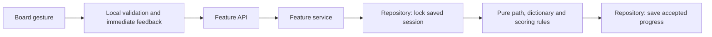

# Froggle rebuild: architecture and decisions

The application composition, state ownership, transport organization, backend boundaries, and startup lifecycle were rebuilt around the capabilities in [FEATURES.md](FEATURES.md) and the supplied [AGENTS.md](../AGENTS.md). Existing presentational markup, design tokens, audio synthesis, and deterministic game algorithms were retained intentionally to preserve the requested visual experience and saved-game compatibility. This distinction matters: the new responsibility structure is independent of the old global context and layer-wide directories; recognizable visual components and proven rules remain.

## Responsibility map

| Owner | Responsibility | Examples |
| --- | --- | --- |
| `client/src/app` | Compose the app, map existing URLs, render navigation chrome, coordinate freshness | `App`, `Routes`, `AppShell`, `FreshnessCoordinator` |
| `client/src/features/<capability>` | Own a product capability's UI, state, API contract, fixtures and tests | timed daily, Zen, Gauntlet, Time is Money, rooms, free play, history, challenges, profile |
| `client/src/ui` | Stable visual primitives and the design system; no feature state or network calls | cells, buttons, date picker, icons, theme tokens |
| `client/src/gameplay` | Shared board interaction, sound, word feedback and acceptance mechanics | circular hit testing, path retraction, word-banner timing, local hash validation |
| `client/src/platform` | Browser mechanisms without game-mode policy | authenticated HTTP, preference storage, monotonic clocks, clipboard, active-run registration |
| `server/features/<capability>/api.ts` | Transport validation, authentication context, HTTP/socket response mapping | existing REST routes and multiplayer events |
| Feature services | Business rules and workflows | starting/ending a run, competition eligibility, sequential rounds, sharing and privacy checks |
| Feature repositories | Kysely/Supabase/memory access, serialization and row translation | locked session reads, result writes, profile metadata, room entries |
| `server/gameplay` | Shared dictionary instance, scoring aggregates and deadline rules | no Express or React dependency |
| `server/platform` | Auth verification, PostgreSQL/Supabase connections, dictionary file loading, central errors/cache | meaningful expected failures; unexpected errors retain their trace |
| `engine` | Pure board, path, dictionary, submission, scoring and solver rules | depends on models and the language runtime |
| `models` | Shared data contracts and canonical invariants | competition ranks, seeds/hashes, Zen thresholds, scoring modifiers, seconds per point |

Dependencies flow from composition into capabilities, then into shared mechanisms and rules. Shared client primitives/mechanisms do not import feature modules. Repositories do not import services. API/service modules do not execute persistence queries. `npm run check:boundaries` enforces these rules.

A typical word submission follows this path:

## State ownership

The former global `GameContext` and aggregate `gameApi` module are removed. The providers now have explicit domains:

- **Identity** restores anonymous Supabase identity and subscribes safely through React StrictMode. Concurrent initial mounts share the bootstrap request.
- **Preferences** owns persisted theme and mute settings.
- **Profile** owns moderated names and readiness for multiplayer handshakes.
- **Timed daily** owns its public puzzle, selected date, saved run, finalized result, countdown and feedback.
- **Zen** owns its puzzle, saved run, casual/competitive choice, feedback and completion workflow.
- **Free play** owns its run, accepted words, result, seed, challenge association and resume probe.
- **Gauntlet, Time is Money and rooms** retain state with their own play capability, since their round progression, growing deadline and live room lifecycle have distinct rules.

Shared word-submission behavior is extracted only for the genuinely identical timed/Zen acceptance contract. It performs immediate hash validation, functional progress updates, persistence and one retry. A run waits for pending submissions before explicit finalization. Shared board gestures and word-banner timing were implemented independently of mode state. The board gesture uses a synchronous gesture ref so fast pointer-up events do not submit an older React render's path.

The active-run registry uses independent registrations with idempotent cleanup. It protects all live modes, including rooms. Freshness coordination remains separate from feature state, and checks again after asynchronous work before reloading. Foreground idle polling still runs every 90 seconds; focus/visibility/bfcache events remain the only build-mismatch reload triggers.

## Server and persistence

`createApplication()` composes Express without listening or starting cleanup timers. `createRuntime()` attaches Socket.io, the room-history bridge, cleanup and orderly shutdown. `index.ts` only starts the runtime and handles process signals. Tests can therefore exercise the real server without introducing a second application implementation.

Each capability colocates transport, workflow and persistence. Results and leaderboard subcapabilities have their own files where their responsibility warrants it. Shared daily-history, word-popularity and definition lookup responsibilities have explicit owners rather than belonging incidentally to timed daily.

Session repositories translate stored JSON into mode sessions. Services decide expiry, valid submissions and finalization. Daily submissions now run under row locks in transactions, so simultaneous distinct words both persist and concurrent duplicates count once. The existing free-play locking semantics are preserved. No generic session framework, repository interface hierarchy, dependency-injection container, new database schema or migration bridge was introduced.

Room state remains process-local, matching the product. The room repository owns its private entries and nudge timestamps; the service owns roster changes, countdown, play and standings transitions; the history module owns deferred completion snapshots; cleanup owns expiration. The history write still waits through the existing final-word grace window, and sharing still waits for that write. Reconnect secrets remain separate from public player IDs.

Expected application failures use `ApplicationError` with semantic codes mapped by the central HTTP error handler. Unexpected failures are logged with the request and original error. Transport handlers are wrapped with `endpoint`, avoiding detached rejected promises. Profile moderation and feedback validation are now service responsibilities; their persistence is in repositories.

## Why these decisions

1. **Treat visual details as compatibility requirements.** Retaining the existing theme and declarative presentation avoids accidental changes in fonts, tile depth, spacing, icon geometry, responsive sizes and transition easing. The new board interaction and word-banner state feed the same visual states. Measurements are backed by rendered comparisons, not just class-name inspection.
2. **Retain deterministic rules.** Replacing the seed generator or board distribution would silently change existing board links, today's shared puzzle and historical comparisons. The calibrated generator, word dictionary, scoring tiers, ranking semantics and solver remain the canonical rules. File loading moved out of the engine so the engine itself is pure.
3. **Use small, capability-owned contexts.** Audio preferences and identity should not rerender or own daily-session business state. Modes should not share transient word feedback accidentally. Feature ownership also makes the code needed to change a mode easy to find.
4. **Keep API, service and repository responsibilities visible.** This gives timing, authorization and integrity a meaningful home while leaving HTTP payloads and database details at their respective edges. Explicit functions and real transaction boundaries provide the required separation without speculative abstractions.
5. **Preserve public compatibility and migrate completely.** Existing browser paths, API URLs, Socket.io events, database migrations, preference keys and saved data remain in use. Every caller was updated. The superseded context, aggregate API, legacy in-memory game controller and unused session middleware were removed. There is no parallel old application inside the production dependency graph.
6. **Verify with isolated real workflows.** Browser tests use a disposable PostgreSQL container and a local auth service issuing signed JWTs and serving JWKS. The application still performs its real JWT verification, API calls, SQL and Socket.io traffic. Production credentials and data are not involved.

## Compatibility corrections included in the rebuild

These preserve the intended experience rather than adding product features:

- Timed daily waits for both session probes before redirecting on refresh, can identify its saved run without transient navigation state, and can finish/view results after a reload.
- Daily progress updates use the latest state, finalization waits for outstanding accepted submissions, and database locks prevent lost simultaneous words.
- Freshness checks cannot reload an active room or apply a late build response after a run starts.
- Board validation rejects malformed/fractional coordinates without crashing a game; gesture feedback is not executed inside a React state updater.
- Share text uses the established clipboard fallback and cleans up its copied-state timer.
- Storybook resolves its framework/addon presets within the workspace; both production and Storybook builds succeed.

## Retained limits and review evidence

Rooms remain ephemeral and single-process. Anonymous identity still depends on browser storage. Definition providers and native sharing remain external/browser capabilities. The rebuild does not add account management, payments, chat, friends, new game modes or a new design.

The original source snapshot is at `.context/original/source.tar`, from revision `3b88e7058244df89db7d4033436002a3f0bd2a6a`, and is used only as a local comparison reference. See [VERIFICATION.md](VERIFICATION.md) for executed checks, visual measurements, reproducibility and remaining limits.
